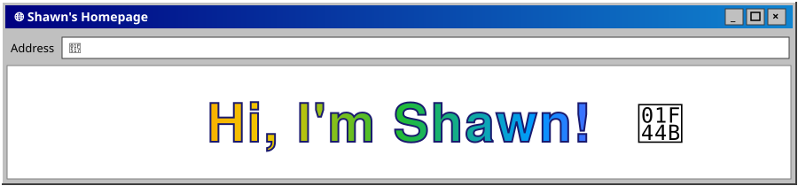

  
    
  
   
  <strong>Software engineer &amp; life blogger.</strong> I build apps, and write about everything else.

<table width="100%" align="center">
<tr>
<td align="center" width="33%">
<a href="https://shawnidea.com"><strong>📝 My Web</strong>  
</a>
</td>
<td align="center" width="33%">
<a href="https://pixelbluellc.com"><strong>🏢 My Org</strong>  
</a>
</td>
<td align="center" width="33%">
<a href="playlist.md"><strong>🎧 My List</strong>  
</a>
</td>
</tr>
</table>

 

 

<!-- Guestbook -->
<table>
<tr><th>Name</th><th>Date</th><th>Message</th></tr>
<tr><td><a href="https://github.com/ShawnCai223">ShawnCai223</a></td><td>–</td><td>Be the first to sign!</td></tr>
</table>
<!-- /Guestbook -->

 

 

&nbsp;&nbsp;
&nbsp;&nbsp;

